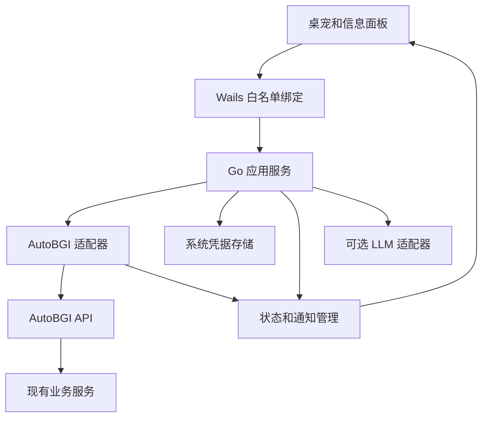
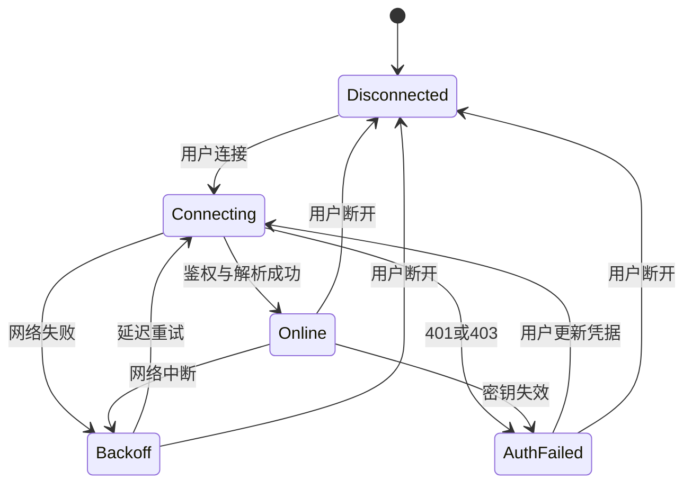

# AutoBGI 桌宠 AI 开发规格

版本：1.0  
基准日期：2026 年 10 月 27 日  
项目建议名：autobgi-pet  
交付对象：负责新项目实现的 AI 编程助手及项目维护者  
首发平台：Windows 11 x64；Windows 10 的兼容范围以实际 Windows 测试结果为准。

开发一个独立运行的 AutoBGI 桌宠客户端。用户填写 AutoBGI 服务地址与 API 密钥后，可以通过桌宠查看运行情况、打开任务面板、接收业务提醒，并在明确选择后执行受支持的控制操作。客户端采用 Go、Wails v3、Vue 3 和 TypeScript，优先实现精灵图动画。自然语言 AI 对话是后续增强项，连接 AutoBGI 和读取状态不依赖大模型。

本规格将“已核实的公开源码事实”“本项目内部模型”和“建议新增的服务端接口”分开标注。任何新增路径、能力标识、事件格式和示例数据，都不能被当作现有 AutoBGI 已经实现的功能。

## 1 项目目标与范围

### 1.1 用户体验

用户安装桌宠，输入服务地址和 API 密钥，点击连接。连接成功后，桌宠可以回答“现在运行到哪里了”，以卡片展示配置组、路线、脚本和进度；有可靠的完成或失败事件时，用动画和气泡提示；需要启动一条龙时，先展示所选实例、账号和配置名称，再执行。

典型交互：

- 点击桌宠：挥手并展示连接状态、当前配置组、当前路线与最近更新时间。
- 双击或菜单“打开面板”：打开独立的信息面板。
- 右键：显示桌宠、切换穿透、查看状态、打开 AutoBGI、连接设置、退出。
- 输入“当前状态”：使用本地规则调用已知查询能力，不需要 LLM。
- 选择一条龙并点击启动：展示具体目标，收到服务端响应后区分“请求已收到”和“已经开始运行”。
- 收到可信任务完成事件：播放一次庆祝动画；相同事件重放不重复提醒。
- 服务断开：显示“连接已断开，上次更新于……”，保留带过期标识的历史信息。

示例文案仅说明产品交互，不代表相应业务字段已存在于当前 API。

### 1.2 版本划分

| 版本 | 必须完成 | 不作为该版本交付前提 |
| --- | --- | --- |
| 0.1 可用首版 | 独立透明桌宠、拖动、托盘、整窗穿透开关、连接管理、apiKey 鉴权、运行概览、规则式查询、错误提示、轮询同步、打包 | 新增服务端事件系统、模型聊天、Live2D |
| 0.2 业务增强 | 经核实的一条龙启动、命令结果核对、账号查询和切换；服务端配合后接入收益、背包、培养计划和可靠事件 | 任意远程命令、任意脚本执行 |
| 0.3 可选扩展 | LLM 工具调用、可选语音、更多皮肤、可选 Live2D、其他桌面系统适配 | 不得因此破坏无模型模式 |

0.1 允许同一客户端保存多个 AutoBGI 连接，但同时只激活一个。账号列表与账号查询必须分别判断服务端是否支持；多实例同时监控不属于首版要求。

### 1.3 业务边界

AutoBGI 继续负责 BGI 控制、运行日志、背包数据、收益统计和角色培养业务。桌宠负责显示、交互、通知、连接与请求编排。

桌宠不复制 BGI 执行引擎，不直接接管原神进程，不重新实现角色培养算法，也不读取 AutoBGI 的本地数据库或配置文件来绕开 API。客户端读取自身配置、缓存和素材文件即可。

## 2 调研基线与参考项目

### 2.1 AutoBGI 基线

项目背景中的 GitHub 地址 `wjdsg0327/abgi` 在本次连接中返回 404，不能据此判断仓库是否删除。接口事实来自原作者公开的 [Gitee ginVue 分支](https://gitee.com/wangjian0327/auto-bgi/tree/ginVue)。

公开分支中的部分接口文件早于用户当前工作分支。开始开发时必须在实际待接入的版本上再次核对路由、请求体和响应；尤其是最近新增的多账号背包与角色培养功能。不能用同名的其他 GitHub 项目代替当前 AutoBGI。

### 2.2 参考项目取舍

| 项目与基线 | 已核实技术栈 | 本项目借鉴内容 | 实施边界 |
| --- | --- | --- | --- |
| [Morrow](https://github.com/Benny66/morrow/tree/6c70831be2ed39a54440d8653d0ca18332214478) | Go 1.25、Wails v3.0.0-beta.23、Vue 3、TypeScript | 独立桌宠窗、气泡几何、拖动、贴边、托盘、精灵图动画 | 按新项目结构选择性移植；其 AI 主要生成提醒计划，不等于通用聊天 Agent |
| [VPet](https://github.com/LorisYounger/VPet/tree/78384d1dd21b026c09462bc34900db41a7b53280) | C#、WPF | 动作状态机、开始和循环与结束动作、交互反馈、皮肤组织 | 借鉴交互模型，不引入整套 C# 桌面工程 |
| [BongoCat](https://github.com/ayangweb/BongoCat/tree/a8d68d63079e302375cce48fab82f15fae75d44d) | 当前版本为 Rust 原生应用、GPUI 设置界面、原生渲染 | 模型窗与设置窗分离、不抢焦点、托盘恢复、穿透与置顶 | 不按旧文章将其现行架构写成 Tauri；不引入其完整渲染与插件系统 |

Morrow 使用 Canvas/SVG 与精灵图，并非 Live2D。其透明窗口仍有矩形命中区域；CSS `pointer-events: none` 不会让鼠标穿过原生窗口。参考其窗口和气泡实现时，应单独验证点击穿透。[R1][R2]

Morrow 的代码许可证是 MIT；VPet、当前 BongoCat 的代码许可证是 Apache-2.0。复用代码时保留对应许可与归属记录。角色图像、动画、字体和 Live2D SDK 分别核对许可，不将代码许可自动套用到全部素材。首版使用原创或明确授权的普通图像素材。[R3][R4][R5]

## 3 技术选型与工程基线

### 3.1 采用的技术栈

| 层 | 选型 | 用途 |
| --- | --- | --- |
| 桌面宿主 | Wails v3.0.0 | 原生窗口、托盘、屏幕、绑定方法与生命周期 |
| 后端 | Go 1.26.10 作为初始锁定版本 | HTTP 客户端、凭据、事件、缓存、业务适配 |
| 前端 | Vue 3、TypeScript、Vite、Pinia | 桌宠画面与信息面板 |
| 动画 | Canvas 2D、PNG/WebP 精灵图 | 首版可控的动画与低帧率渲染 |
| 本地非敏感配置 | JSON，临时文件加原子替换 | 几何、外观、连接资料和偏好 |
| 敏感凭据 | Windows Credential Manager；必要时实现用户范围 DPAPI 存储 | API 密钥保护 |
| 持久缓存 | 首版限量 JSON；需要事件游标与历史记录时再引入 SQLite | 避免为简单首版提前增加数据库 |
| 测试 | Go testing、Vitest；Windows GUI 手动或专项自动化 | 契约、状态、交互与实机验证 |

Wails v3.0.0 已于 2026 年 10 月 26 日发布为桌面稳定版；其模块要求 Go 1.26.0，工具链基线为 Go 1.26.10。Morrow 锁定的 beta 版本与此不同，复制代码前必须适配 API。框架刚发布稳定版，M0 的 Windows 原型验证仍是必要门槛。[R6]

依赖版本在初始化后写入 `go.mod/go.sum` 与前端锁文件。`@wailsio/runtime` 与 Wails 版本保持一致。后续安全补丁在兼容验证后更新，不将 `latest` 写入可重复构建流程。Node.js 与包管理器版本按所选模板的 engines 和锁文件记录，不修改 AutoBGI 主项目的工具链。

### 3.2 初始化命令

以下命令在用于开发的 Windows 终端执行。先安装指定 Go 工具链、满足模板要求的 Node.js、以及 WebView2 运行环境。

```powershell
go install github.com/wailsapp/wails/v3/cmd/wails3@v3.0.0
wails3 doctor

wails3 init -n autobgi-pet -t vue
cd autobgi-pet

wails3 dev
wails3 build
```

在 v3.0.0 中，`vue` 就是 Vue + TypeScript 模板，`vue-js` 才是 JavaScript 模板。构建输出以生成的 Taskfile 为准，当前公共模板的 `BIN_DIR` 默认为 `bin`。[R7]

先只构建独立桌宠。需要扩展 AutoBGI 时，在 AutoBGI 中新增小范围适配模块，保持原项目已有启动与部署方式。

## 4 总体架构



### 4.1 责任分配

前端只调用明确的绑定方法，例如 `Connect`、`GetSnapshot`、`ListPresets`、`PrepareCommand`、`ConfirmCommand`。不得暴露“任意 URL 请求”“任意 HTTP 方法”“执行 Shell”“读取任意文件”等通用能力。

Go 层持有凭据、复用 HTTP 客户端、处理超时和重连、解析原始响应、生成统一 DTO。前端只拿到脱敏连接信息与业务数据。用户首次输入的密钥可通过一次性绑定传给 Go；保存后清空输入，不提供读取完整密钥的绑定。

WebView 只加载打包的受信任资源；AutoBGI 网页和外部链接在系统浏览器打开。日志、昵称和模型文本默认按纯文本渲染；需要 Markdown 时使用受限解析与清理，禁止任意 HTML、iframe、脚本和窗口内远程导航。

同一连接只建立一个采集循环或事件连接，再向所有窗口分发。关闭面板不创建第二套采集器。

### 4.2 适配器模式

定义 `AutoBGIAdapter`，至少包含：

```go
type AutoBGIAdapter interface {
    Probe(ctx context.Context) (Capabilities, error)
    GetSnapshot(ctx context.Context, query SnapshotQuery) (Snapshot, error)
    ListAccounts(ctx context.Context) ([]Account, error)
    ListPresets(ctx context.Context, accountID string) ([]TaskPreset, error)
    ExecuteCommand(ctx context.Context, command CommandRequest) (CommandReceipt, error)
    GetCommand(ctx context.Context, commandID string) (CommandReceipt, error)
    Subscribe(ctx context.Context, query EventQuery, emit func(Event)) error
}
```

这是本项目内部接口设计，不是现有 AutoBGI 的 Go 接口。各参数和返回类型按本规格建立 DTO。

实现两个适配器：

- `LegacyAdapter`：仅对已经核实的现有接口做映射。未支持的方法返回明确的 `UNSUPPORTED_CAPABILITY`；采用轮询读取状态。
- `PetV1Adapter`：接入第 11 节建议新增的桌宠 API，支持结构化任务、账号、事件及幂等命令。

UI 不判断服务端原始路径，也不直接依赖旧接口的中文字段和大小写差异。

## 5 现有 AutoBGI 接口与密钥约定

### 5.1 正确的 API 密钥

在已核实的公开源码中，中间件读取 `apiKey` 请求头，并与 `User.Auth.APIKey` 比对。配置由 `abgiUser.yaml` 的 `auth.api_key` 加载。README 中可能写作 yml，开发时以实际版本的加载代码为准。[R8][R9]

```http
GET /api/index HTTP/1.1
Host: 127.0.0.1:8082
Accept: application/json
apiKey: <AUTO_BGI_API_KEY>
```

AutoBGI 的 APIKey、联机配置中的 `Account.SecretKey`、可选模型服务的 API Key 是不同凭据。不能把联机密钥填作 API 密钥，也不能把 AutoBGI 密钥发给模型服务。

现有 APIKey 是实例级凭据。公开中间件没有显示账号级授权或读写 scope 检查。客户端的“只读模式”只能限制客户端自身行为；服务端若需要真正的只读或按账号授权，必须新增服务端校验。

### 5.2 已核实接口清单

下表只描述公开分支中确认的行为，正式开发需用实际目标版本再次核验。[R10][R11]

| 方法与路径 | 请求 | 当前确认的语义 | 桌宠用途 |
| --- | --- | --- | --- |
| `GET /api/index` | 无业务请求体 | 返回裸状态对象 | 首版连接验证和运行概览 |
| `GET /api/appInfo` | 无业务请求体 | 返回应用信息；处理过程会查询远程版本 | 连接后低频获取，不能高频心跳 |
| `GET /api/oneLong/oneLongAllName` | 无业务请求体 | 返回 `status` 与 `data`，其中包含一条龙名称列表 | 按实际版本核实后映射为可选项 |
| `POST /api/oneLong/startOneLong` | JSON 字符串 | 启动指定一条龙 | 只在用户明确选择并确认后执行 |
| `POST /api/closeBgi` | 按实际版本校验 | 同时关闭 BGI 和原神 | 显示准确名称；不是暂停任务 |
| `POST /api/closeYuanShen` | 按实际版本校验 | 关闭原神 | 默认不放在桌宠快捷入口 |
| `GET /api/indexSX` | 无业务请求体 | 重启 AutoBGI | 禁止作为刷新或连通性探测 |

启动一条龙的旧接口请求体是 JSON 字符串，例如：

```json
"日常一条龙"
```

不能直接改成 `{"name":"日常一条龙"}`。客户端用 JSON 编码器序列化名称，不手工拼接引号。名称必须从服务端返回的列表中选择，并在发送前重新验证目标连接。

### 5.3 状态响应的准确解释

`GET /api/index` 在公开源码中包含如下字段：

| 原始字段 | 内部映射 | 解释 |
| --- | --- | --- |
| `group` | `task.groupName` | 配置组与一条龙进度拼接的展示文本，不是稳定 ID |
| `ExpectedToEnd` | `task.etaText` | 大小写保持原样；这是展示文本，不能直接当 RFC3339 时间 |
| `line` | `task.routeName` | 路线展示字段 |
| `scriptName` | `task.scriptName` | 脚本名 |
| `progress` | `task.progressText` | 原始进度文本 |
| `jsProgress` | `task.scriptProgressText` | JS 进度文本 |
| `running` | `process.running` | 来源为 BetterGI.exe 进程检测 |
| `title` | `instance.displayName` | 展示名称 |

**`process.running = true` 不证明一条龙正在运行；`false` 不证明任务成功。**旧接口没有可靠 taskId、终态或完成事件时，`task.state` 保持 `unknown`，展示配置组和进度文本即可。不得根据进程消失或文本“已经结束”自动生成“任务成功”通知。[R11]

首版不把多行 `ExpectedToEnd` 强行解析成 ETA 时间；只有服务端提供结构化时间后才显示倒计时。不可解析的进度显示原文，不能伪造百分比。

### 5.4 现有 MCP 与实时通道

公开分支含 `/mcp/sse` 和 `/mcp/messages`，以及 `findBgiIndex`、`RunCronTask`、`queryBackpack` 工具。它们是 MCP JSON-RPC 传输与工具，不是桌宠业务事件流。消息入口和 SSE 建连的鉴权路径也不同，不能直接视作已经完成鉴权的统一状态订阅。[R12]

首版使用已核实的 REST 读取。接入 MCP 前，单独核对目标版本的协议、鉴权、账号边界与每个工具的副作用。尤其应审查公开 `RunCronTask` 的参数校验与实际执行链路，防止重复或提前执行；不直接把该通用工具交给模型。[R13]

`/api/abgiWs` 相关联机能力不能凭名称当成桌宠状态广播。未确认消息格式和账号隔离之前，不接入。

## 6 连接与凭据管理

### 6.1 连接资料

每个 profile 包含：

```typescript
interface ConnectionProfile {
  id: string;
  name: string;
  baseUrl: string;
  credentialRef: string;
  adapterMode: "auto" | "legacy" | "pet-v1";
  preferredAccountId: string | null;
  readOnly: boolean;
  autoConnect: boolean;
}
```

`credentialRef` 是系统凭据标识，不是密钥。连接资料可以导出；凭据不能随导出文件附带。`readOnly` 默认开启，启动任务等操作在用户启用控制功能后才可用。

首版默认提示地址 `http://127.0.0.1:8082`，用户可以修改。不得扫描局域网或自动尝试默认密码。

### 6.2 地址规则

地址必须是 HTTP 或 HTTPS 服务地址，禁止 userinfo、查询参数、片段与任意脚本协议。允许反向代理的固定基础路径，拼接路由时保留该路径；在契约测试中覆盖带路径前缀的情况。

本机回环地址可以使用 HTTP。远程地址默认要求 HTTPS；局域网明文兼容由用户在该 profile 上显式启用，界面说明密钥会经明文传输。禁止通过关闭证书验证解决 TLS 错误。

请求只向当前 profile 的允许来源发送凭据。重定向默认不跟随，展示可读错误；不得把 `apiKey` 自动转发到新来源。打开 AutoBGI 网页使用不带密钥的 URL，网页按自身登录流程处理。

### 6.3 凭据保存

优先使用 Windows Credential Manager。若使用 DPAPI，采用当前用户范围，不设置机器范围共享。系统凭据保护不等于可以阻止同一用户权限下的恶意进程读取，产品不作绝对保密承诺。[R14][R15]

凭据不可写入：

- 普通 JSON、SQLite 明文字段、localStorage、URL 查询参数。
- 日志、错误堆栈、诊断导出、截图说明、模型提示词。
- Git、示例配置、打包资源、自动更新元数据。

保存失败时明确提示，允许“仅本次会话使用”，不得静默回退到明文保存。断开连接仅关闭网络；删除 profile 时才删除相应凭据。修改凭据会取消旧请求、关闭旧流并重新认证。

### 6.4 连接状态机



401/403 停止自动重试并提示检查凭据或权限；不能持续刷请求。网络错误采用 1、2、4、8、16、30 秒封顶退避，并加入 20% 抖动。连续稳定 60 秒后重置退避。用户主动重连可以立即进行一次尝试。

连接成功至少同时满足：HTTP 状态正确、响应不是 HTML 登录页、必需字段解析正确、回包属于当前 profile 和 generation。新接口还校验服务端 instanceId；legacy 未提供该字段时保持 null，只校验请求来源与连接上下文，不伪造已核实的实例身份。仅 TCP 可达不算连接成功。

## 7 状态同步与账号隔离

### 7.1 首版轮询

`LegacyAdapter` 以 `/api/index` 为主要来源。建议默认：

| 场景 | 轮询间隔 |
| --- | --- |
| 面板展开或存在活动进度信息 | 5 秒 |
| 面板关闭且长期无变化 | 15 秒 |
| 手动刷新 | 合并到当前请求，最多每秒一次 |
| 鉴权失败 | 停止，等待用户处理 |
| 设备休眠或系统断网 | 暂停；恢复后先取一次完整快照 |

同一来源最多一个在途状态请求。HTTP 普通请求总超时建议 10 秒，连接超时建议 3 秒；这些是本项目初始配置，不是 AutoBGI 服务端保证。状态采集失败保留旧值并标记过期，不能显示 0 收益或“已停止”。

轮询模式只保证最终读取到最新状态。短暂事件可能发生在两次轮询之间，因此可靠的任务完成通知需要第 11 节事件扩展。

### 7.2 内部快照模型

下列是规范化后的客户端对象，不能原样用来反序列化旧接口：

```typescript
interface Snapshot {
  profileId: string;
  serverInstanceId: string | null;
  accountId: string | null;
  accountLabel: string | null;
  scope: "instance" | "account";
  sourceMode: "legacy" | "pet-v1";
  stateVersion: string | null;
  eventCursor: string | null;
  sourceTime: string | null;
  fetchedAt: string;
  stale: boolean;
  process: { running: boolean | null };
  task: {
    id: string | null;
    state: "unknown" | "idle" | "queued" | "running"
      | "succeeded" | "failed" | "cancelled";
    groupName: string | null;
    routeName: string | null;
    scriptName: string | null;
    progressText: string | null;
    scriptProgressText: string | null;
    etaText: string | null;
    etaAt: string | null;
  };
}
```

时间使用带时区的 RFC3339 字符串。数据不足时用 `null`；不能把未知数量、未知时间或未获取的账号写成零值。`stateVersion` 和 `eventCursor` 只由支持的新服务端提供，legacy 均为 null。

服务器业务日与客户端操作系统日期分开。收益汇总使用服务端返回的 `businessDate` 与 `timeZone`；不得默认为 UTC，也不得未经配置把“今日”替换为原神每日刷新周期。

### 7.3 多账号必须从服务端确定

明确区分：

- `profileId`：桌宠本地保存的连接配置。
- `serverInstanceId`：服务端实例标识；旧版不提供则为 null。
- `accountId`：服务端可识别的游戏账号。
- 昵称：仅作展示，不用作缓存键或权限依据。

旧版只提供实例状态时显示“实例概览，账号未提供”。不因为用户在前端选择了昵称，就把实例共享日志当成该账号专属数据。

切换账号时：

1. 增加连接上下文的 `generation`。
2. 取消旧请求、旧订阅和旧确认卡片。
3. 清除旧账号可见状态，立即显示新账号的加载状态。
4. 加载以 `profileId + serverInstanceId + accountId` 为键的缓存。
5. 后续回包必须同时匹配上下文和 generation，否则丢弃。
6. 快照、通知、命令回执都带所属上下文，不能相互覆盖。

服务端必须校验账号归属或明确声明“同一实例管理员可访问全部账号”。下拉框切换不是授权隔离。若服务端只支持全局当前账号，桌宠不得自行修改该全局账号来模拟查询切换。

## 8 桌宠窗口与交互

### 8.1 窗口职责

采用三个窗口角色，按需创建，避免全屏透明窗口：

| 窗口 | 用途 | 焦点与生命周期 |
| --- | --- | --- |
| PetWindow | 角色动画、短交互 | 紧凑透明窗，默认不抢焦点，随应用常驻 |
| BubbleWindow | 短通知和状态摘要 | 临时小窗，贴近角色，自动收起；长内容转面板 |
| PanelWindow | 概览、连接、账号、任务、设置、后续聊天 | 用户主动打开才获取焦点；关闭默认隐藏 |

可以把气泡作为 PetWindow 的动态扩展区域实现，但必须完成同等的几何、点击区域与拖动测试；不得用 CSS 溢出代替原生窗口尺寸调整。

### 8.2 原生行为

- 无边框、透明背景、可开关置顶、记住位置和缩放。
- 拖动时不触发单击业务；双击与单击需要去歧义。
- 角色和气泡展示不抢走游戏或编辑器的键盘焦点。
- 打开长面板由明确点击触发。
- 托盘提供“显示桌宠”“关闭穿透”“重置位置”“打开面板”“断开连接”“退出”。
- 快捷键默认可配置；注册冲突时提示并保留托盘恢复入口。
- 隐藏角色仍保持连接；断开连接才取消网络；退出才清理全部资源。
- 第二次启动唤起现有实例，不重复托盘、连接或事件通知。
- 托盘创建失败时必须留有可见窗口或明确退出方式，不能留下无法找到的后台进程。

### 8.3 点击穿透

首版采用两种明确模式：

1. 交互模式：角色可以点击和拖动；保持原生窗口矩形紧凑。
2. 穿透模式：整窗不接收鼠标事件，从托盘或快捷键恢复。

Wails v3 提供整窗 `IgnoreMouseEvents` 能力，透明像素级命中需要另外设计和实测。不得把 CSS 透明与原生穿透混为一谈。像素级自动穿透列为增强项，不阻塞上述两种模式的首版交付。[R16]

### 8.4 多屏与 DPI

位置以逻辑坐标存储，保留 monitor 信息与相对工作区位置。启动、显示器变更、缩放变化和睡眠恢复后，按真实 monitor work area 校正；不能只用虚拟屏幕整体矩形，因为其中可能存在不可见空隙。

保留宠物至少一块可交互区域在可见工作区内。原显示器消失时回到主屏工作区。托盘“重置位置”必须随时可用。气泡优先在上方展开，空间不足时换侧并夹取边界，不能被任务栏或屏幕边缘裁掉。

游戏全屏或用户勿扰时可以隐藏桌宠或暂停气泡。选择隐藏不等于断开连接，也不触发控制命令。

## 9 动画与素材协议

### 9.1 状态分层

连接状态、进程状态、任务状态和动画状态分别保存。动画播放结束不修改任务状态，用户拖动也不改变服务器状态。

| 条件 | 表现 | 回落规则 |
| --- | --- | --- |
| 无连接 | offline | 连接成功后回到当前业务状态 |
| 连接正常，只有进程存活信息 | idle 加“BGI 在线”标识 | 不宣称正在执行一条龙 |
| 结构化任务确认为 running | working | 根据下一条真实状态变化 |
| 结构化 succeeded 事件 | success，短时庆祝 | 播放完重新读取当前状态 |
| failed 事件或明确错误 | warning | 用户已读后按最新状态回落 |
| 用户拖动 | dragging | 松开后回落 |
| 用户点击 | wave | 播放完成后回落 |
| 用户休息或勿扰设置 | sleep 或静止 | 用户操作或配置恢复 |

建议优先级：用户拖动 > 当前严重错误提示 > 短时完成反馈 > 连接失效提示 > 工作态 > 普通交互 > 待机。所有短时状态都有超时，禁止卡在 success 或 waving。

### 9.2 动画资源包

首版内置一套授权明确的基础角色。导入包格式由本项目定义，不硬编码 Morrow 的固定行列。

```json
{
  "schemaVersion": 1,
  "id": "abgi-buddy",
  "name": "ABGI 小助手",
  "author": "项目作者",
  "license": "本资源的实际许可标识或声明文件",
  "atlas": "atlas.png",
  "frameWidth": 192,
  "frameHeight": 208,
  "columns": 8,
  "rows": 9,
  "scale": 1,
  "anchor": {"x": 0.5, "y": 1},
  "actions": {
    "idle": {"frames": [0,1,2,3,4,5,6,7], "fps": 8, "loop": true},
    "wave": {"frames": [8,9,10,11,12,13,14,15], "fps": 12, "loop": false},
    "working": {"frames": [16,17,18,19,20,21,22,23], "fps": 10, "loop": true},
    "success": {"frames": [24,25,26,27,28,29,30,31], "fps": 12, "loop": false}
  },
  "fallbackAction": "idle"
}
```

该 JSON 是自定义协议示例。发布素材必须用真实许可证替换示例声明，并验证图像布局。缺失动作回落 idle；必须有有效 idle。

渲染使用 `requestAnimationFrame` 加时间节流，不能每帧请求 Go 或网络。可见待机建议 8–12 FPS，交互动作按资源设置；隐藏或休眠时暂停渲染。Canvas 按 devicePixelRatio 设置内部像素并限制上限，防止高 DPI 下资源失控。

### 9.3 导入与资源限制

首版仅接受 manifest 与允许格式的图片，不加载用户脚本、HTML、可执行文件或远程资源。若支持 ZIP：

- 限制文件数量、压缩包大小、解压总大小、单张像素数。
- 拒绝绝对路径、目录穿越、符号链接和重复覆盖敏感路径。
- 校验图片实际解码结果，不能只看扩展名。
- 先在临时目录校验，全部成功后原子安装；失败不损坏现有皮肤。
- 素材错误回退内置角色，并提示原因。

Live2D 放在独立 renderer 接口后面。启用前确认 SDK 分发条件与模型许可，不因为代码开源就认定所有模型可随程序发布。[R17]

## 10 功能面板与业务交互

### 10.1 概览

面板顶部固定显示当前连接与账号上下文，下面展示：

- 连接状态、数据时间与是否过期。
- BGI 进程是否存在。
- 配置组、路线、脚本、原始进度与预计结束展示文本。
- 当前能力可用的收益、背包、培养计划摘要。
- 刷新、打开 AutoBGI 网页、查看任务。

未知能力显示“当前服务版本未提供”，不能留一个能点击但永远失败的按钮，也不能把空白写成零。

### 10.2 规则式问答

首版支持少量确定指令：

| 输入示例 | 行为 |
| --- | --- |
| 当前状态、现在运行到哪了 | 获取并展示 Snapshot |
| 有哪些一条龙 | 获取配置列表 |
| 打开 AutoBGI | 用系统浏览器打开配置地址，不附密钥 |
| 今天收益 | 能力可用时查询；否则解释当前版本未提供 |
| 查看培养计划 | 能力可用时查询；否则引导打开既有页面 |

模糊的“启动那个”“换个号”“停一下”不得猜测目标，展示可选择的动作和账号。规则识别失败时给出支持示例，不自动进入任意命令执行。

### 10.3 一条龙与危险动作

现有接口的成功响应可能只表示入口处理完成。客户端区分：

- 已准备：用户已选择，但尚未发送。
- 已发送：请求正在进行。
- 已受理：服务端收到请求。
- 已观察到执行：结构化任务或可靠状态证据证实开始。
- 结果未知：请求超时或响应丢失。
- 失败：服务端明确拒绝或终态失败。

启动前显示连接、账号范围和配置名。旧版未确认账号归属时，显示“实例级操作，游戏账号以 AutoBGI 当前配置为准”，不能伪装为针对下拉框账号执行。

旧版启动请求超时后不得自动重发；显示“结果未知，请检查 AutoBGI 当前状态”。客户端按钮防抖不能替代服务端幂等。

停止与暂停按真实语义展示。没有优雅停止接口就不提供“暂停”或“停止当前任务”的假能力。`closeBgi` 若提供入口，按钮必须叫“关闭 BGI 和原神”，说明会中断运行并二次确认；默认不放在常用气泡中。

### 10.4 收益与背包

收益采用服务端结构化值与业务日，不在桌宠端重复解析日志或自行累加可能重复的推送。缺失值为 null，不能表示为 0。

背包摘要必须带 accountId、扫描时间与数据版本。只读展示材料名、库存和缺口。新扫描未完成时展示上次结果及其时间；不同账号数据不能复用同一缓存。

对旧接口只有材料名称、缺少稳定 materialId 的情况，适配器明确记录这种限制；未经统一映射不能合并同名或翻译相近材料。

### 10.5 角色培养计划

以当前 AutoBGI 的 `MysTool.vue`、`BgiConfig.vue` 和实际后端服务为业务依据，桌宠展示计划顺序、当前角色、材料缺口、剩余目标与完成事件，不在客户端重算整套计划。

沿用既定业务约束：

- 角色按加入顺序推进。
- 摩拉和智识之冕不作为培养计划完成条件。
- 使用当前“每日秘境”流程，不恢复已经被替换的“每周秘境”流程。
- 当前角色完成时告知用户并展示下一个角色；全部完成时提示添加新计划。
- 全部培养完成后，一条龙仍正常运行，只是不再自动填充培养秘境。

这些规则由 AutoBGI 服务端执行。桌宠仅消费结果；除非另有经过确认的编辑功能，否则不修改计划、开启开关或填充配置。

## 11 建议新增的桌宠 API

本节全部为拟新增契约。可运行首版不依赖它们；若需要可靠事件、稳定账号查询和可重试命令，则在 AutoBGI 内新增此薄层，内部调用已有业务服务。不得在桌宠中伪造这些路径的存在。

### 11.1 路由清单

统一前缀 `/api/desktop-pet/v1`，沿用现有 `apiKey` 请求头鉴权。

| 路由 | 用途 | 要求 |
| --- | --- | --- |
| `GET /capabilities` | 协议版本、实例、功能与数据范围 | 每个能力单独报告 |
| `GET /accounts` | 可访问账号列表 | 只返回允许访问的账号 |
| `GET /snapshot?accountId=...` | 一致性快照 | 返回最新状态及事件游标 |
| `GET /task-presets?accountId=...` | 可启动的一条龙等配置 | 具有稳定 presetId |
| `GET /earnings?accountId=...&date=YYYY-MM-DD` | 结构化收益 | 返回 businessDate 和 timeZone |
| `GET /backpack?accountId=...` | 背包摘要 | 返回扫描时间与版本 |
| `GET /cultivation-plans?accountId=...` | 培养队列摘要 | 复用已有计划服务 |
| `GET /events?accountId=...` | SSE 业务事件 | 完整鉴权、游标、重连与保活 |
| `POST /commands` | 提交白名单命令 | 服务端幂等、对象校验、冲突检测 |
| `GET /commands/{commandId}` | 查询命令回执 | 超时后对账，不盲目重发 |

无账号能力时可省略 accountId，但必须在 capabilities 明确 `accountScope: "instance"`；此时服务端拒绝传入伪造 accountId。具备账号能力时，账号相关查询必须提供真实 ID，并校验归属。

### 11.2 统一响应

以下是拟新增接口成功响应的示例，字段值均为演示：

```json
{
  "code": "OK",
  "message": "",
  "requestId": "req-example-001",
  "serverTime": "2026-10-27T11:00:00+08:00",
  "data": {
    "apiVersion": "1.0",
    "instanceId": "instance-example",
    "accountScope": "instance",
    "executionScope": "instance",
    "features": {
      "snapshot": true,
      "accounts": false,
      "events": false,
      "earnings": false,
      "backpack": false,
      "cultivationPlans": false,
      "commandStatus": false,
      "commandIdempotency": false
    },
    "commands": [],
    "commandPolicy": null
  }
}
```

只对实际可用能力返回 true。客户端按能力隐藏或禁用功能，不能根据 AutoBGI 版本号猜测能力。示例只开放读取；当新服务端开放命令时，应同时实现 commandStatus 与 commandIdempotency，并返回具体 commands。

`accountScope` 描述数据范围；`executionScope` 描述互斥执行资源的范围，允许多账号读取但共享同一个实例执行器。支持幂等命令时，`commandPolicy` 返回 `idempotencyRetentionSeconds` 和 `resultRetentionSeconds`，初始建议分别为 86400 与 604800 秒。命令回执还返回 `acceptedAt`、`dedupeExpiresAt`、`resultExpiresAt`，供客户端判断重试及结果查询窗口。旧版没有这些保证，不填虚构值。

新 `/snapshot` 的 data 至少返回 `instanceId`、`accountId`、`scope`、`stateVersion`、`eventCursor`、`sourceTime`、`process` 和 `task`。`stateVersion` 是按执行资源维护的不透明并发版本：任务占用、运行账号、任务配置等会影响命令前置条件的变化必须更新它；心跳、轮询和普通进度文本更新不改变它。客户端只比较版本相等与否，不解析或自行递增。`eventCursor` 是同一快照对应的事件日志位置，随数据事件推进；它和 stateVersion 不能互相替代。

统一错误包括 `AUTH_INVALID`、`FORBIDDEN`、`ACCOUNT_NOT_FOUND`、`UNSUPPORTED_CAPABILITY`、`INVALID_ARGUMENT`、`TASK_BUSY`、`VERSION_CONFLICT`、`IDEMPOTENCY_CONFLICT`、`RESYNC_REQUIRED`、`RATE_LIMITED`、`INTERNAL_ERROR`。HTTP 状态与错误语义一致：401、403、404、400、409、410、429、5xx。

能力协商规则：

1. 尝试桌宠 capabilities 接口。
2. 仅明确 404/未实现且旧接口验证成功时进入 legacy。
3. 401/403 不触发降级，不尝试匿名访问。
4. 返回 HTML、结构不符或未知协议主版本时显示兼容错误。
5. 控制命令只有服务端声明、适配器实现、客户端策略允许三者同时满足才启用；PetV1 还要求命令回执与幂等能力可用。Legacy 的手动单次调用按第 10 节处理，不享有新协议的重试保证。

### 11.3 可靠事件

采用 SSE 传输服务端到客户端的通知，命令仍走 HTTP POST。Go 层订阅 SSE 可以带 `apiKey` 请求头；前端不直接用原生 EventSource 处理凭据。

SSE 帧示例：

```text
id: epoch-a:1042
event: task.finished
data: {"schemaVersion":1,"eventId":"epoch-a:1042","instanceId":"instance-example","accountId":"account-example","taskId":"task-example","type":"task.finished","occurredAt":"2026-10-27T11:00:00+08:00","data":{"result":"succeeded","summary":"日常一条龙完成"}}

```

每个事件包含 schemaVersion、eventId、instanceId、accountId（实例事件可为 null）、type、occurredAt、data。任务类事件必须有 taskId。sequence 或 cursor 由服务端生成，不能依赖客户端时间推断顺序。

建议事件类型：

- `snapshot.updated`：状态版本变化。
- `task.started`、`task.progress`、`task.finished`：任务状态。
- `earnings.updated`、`backpack.updated`：数据版本更新。
- `cultivation.character_completed`、`cultivation.all_completed`：培养计划推进。
- `server.notice`：服务端通知。

初次同步时，服务端原子返回快照及该快照对应的 eventCursor；客户端从该 cursor 之后订阅，防止“先读快照再订阅”之间漏事件。此原子性由服务端协调状态版本与事件日志实现，不只是在 JSON 上增加一个字段。

重连通过 `Last-Event-ID` 传回已处理游标。事件流按至少一次投递设计；客户端按实例、账号与 eventId 去重，不声称网络上的 exactly once。游标与去重记录按 `instanceId + subscriptionScope` 持久化，subscriptionScope 包含账号或明确的实例订阅范围；切换账号不得复用其他范围的游标。

启用可靠事件的阶段使用 SQLite 或等价事务存储，在同一事务中记录已处理事件、最新游标、状态更新与待显示通知。事件唯一键防止重放创建重复通知。通知展示采用最多一次尝试：先将通知原子标记为 attempted，再调用气泡或系统通知；崩溃边界允许只留未读历史而不补弹。不能原子完成的外部 UI 展示不承诺 exactly once，也不把 attempted 等同于用户已读。服务端建议保留最近 24 小时或 10,000 条事件，达到任一限制即可淘汰；明确返回重同步信号。

游标过期时重新取快照并更新游标，不把快照中的历史终态当成新事件弹窗。服务重启使用新的 epoch 或持久游标，避免序号回退引发重复或误丢弃。

保活建议每 15 秒发送 SSE 注释；客户端 45 秒未收到任何帧时重连。SSE 使用独立长连接配置，不能套用普通请求的 10 秒总超时。支持多行 data、CRLF、分片帧、注释、重连和大小限制。

事件流每次建连必须鉴权；密钥轮换后关闭旧流。若后续引入 scoped token，还需要在重连及存量连接上处理撤销。不能仅在 URL 路由外声明“有密钥”而省略实际验证。

### 11.4 命令提交与幂等

命令示例：

```json
{
  "commandId": "8a034754-cc93-41bf-a922-829a60f8ad50",
  "type": "oneLong.start",
  "accountId": "account-example",
  "params": {"presetId": "preset-daily"},
  "expectedStateVersion": "state-52"
}
```

实例模式的 accountId 为 null，服务端明确按实例配置执行。该新命令 JSON 与旧接口接收的名称字符串不同；只能通过对应适配器转换，不能混发。

建议返回 HTTP 202 与 commandId、status、taskId（未产生时为 null）。status 使用 `accepted / executing / succeeded / failed / rejected / unknown`；命令 succeeded 表示控制动作完成，整个业务任务是否完成仍由 task 状态判断。

服务端要求：

1. 对有效命令先持久登记 commandId 与请求摘要，再调度业务动作。
2. 去重键包含认证主体或实例、账号及 commandId，并建立持久唯一约束。使用事务或原子状态迁移登记和认领调度，同一命令只能有一个执行者。禁止用不加约束的“先查询再插入”去重。相同键和相同请求返回原回执；相同键但参数不同返回冲突。
3. 同一账号或共享执行器已有互斥任务时返回 TASK_BUSY，不偷偷强停。
4. expectedStateVersion 变化时重新核对条件，必要时返回冲突，让用户重新确认。
5. 重复提交不产生重复任务；幂等记录的保留时间明确写入契约。
6. 恢复时区分“确认尚未派发”和“可能已经派发”：前者可以重新认领并调度；后者先核对执行器。尤其在底层执行器调用后、结果写回前崩溃时，无法判断则标记 unknown，不能自动再次执行。

客户端本地生成并记录 commandId、请求摘要与首次尝试时间，超时优先查询回执。只有服务端声明支持幂等且仍在保留窗口内时，才允许用同一 commandId 重试。保留窗口以回执的 dedupeExpiresAt 和服务端时间为依据；尚未拿到回执时，只能在当前会话中依据已协商保留时长与单调时钟保守判断，超期、服务身份改变或重启后无法判断时均不自动重发。同一用户再次主动启动一个新任务，使用新的 commandId。

客户端先生成待确认卡片，冻结 profile、instance、account、动作和参数。确认后若上下文改变、卡片超过 60 秒或状态版本变化，卡片失效。不要使用能被任意前端调用伪造的 `confirmed: true` 布尔值作为唯一保护。

## 12 通知规则与信息一致性

通知由统一 NotificationCenter 排队，来源是已经验证的业务事件或明确的连接错误。原始日志仅作展示数据，不直接变成可执行命令，也不把“出现 ERROR 字样”一律当作整条任务失败。

规则：

- 任务完成和失败按 eventId 去重。
- 同一任务的进度更新合并，只保留最新一条，不连续弹气泡。
- 同一原因的断网提示每个断线周期最多一次。
- 错误优先于普通完成提示；任务完成优先于普通进度。
- 普通气泡建议展示 5 秒，长说明转面板；队列超过 20 条时聚合摘要。
- 勿扰期间记录通知但不抢焦点、不播放声音；恢复后只显示未读摘要。
- 不同时默认触发声音、系统通知和气泡；用户分别选择提醒渠道。
- 服务器重连补发历史事件时，可以更新历史记录，但按通知水位与过期阈值避免集中轰炸。

legacy 轮询只能生成诸如“连接恢复”“当前配置组变化”的事实提示；没有可靠终态时不能承诺“全部完成”。系统错误与游戏任务错误要用不同文案。

## 13 可选 AI 聊天

“给 AI 开发”是本规格的交付方式，不能自动扩展成首版必须集成大模型。0.3 再接入 LLM 时，使用可替换 provider，LLM 凭据与 AutoBGI 凭据分开。

### 13.1 工具边界

建议允许的只读工具：

- `get_status`
- `list_task_presets`
- `get_today_earnings`
- `get_backpack_summary`
- `get_cultivation_plan`

读工具从确定的当前上下文查询结构化数据。模型不能自行提供任意 URL、HTTP 请求头、Shell、文件路径或 API 密钥。

写工具仅生成 `propose_command`。模型输出意图后，客户端生成清晰的确认卡片，再通过同一 CommandService 执行。按钮触发与模型触发使用同一权限、状态核对和命令去重流程。

### 13.2 回答约束

- 根据工具结果回答，明确数据所属账号和更新时间。
- 工具未返回数量就说明暂无数据，不补造收益或材料。
- 日志、昵称、角色描述、远程返回文本均作为数据，不作为系统指令。
- 敏感凭据、Cookie、完整本地路径与原始桌面截图不进入提示词。
- 超时、额度用尽或模型服务不可用时，规则式查询和按钮仍可工作。
- 首版模型增强不需要长期记忆、自动联网搜索或自主执行循环。

## 14 建议目录与模块职责

以 Wails 模板生成的入口、构建文件和 bindings 目录为准，按以下职责组织业务代码；不要为了匹配目录清单破坏模板构建。

| 路径建议 | 职责 |
| --- | --- |
| `main.go` | 创建应用、注册服务、生命周期 |
| `internal/desktop/` | 窗口、托盘、DPI、屏幕恢复、单实例 |
| `internal/profile/` | 连接资料、切换、generation |
| `internal/credential/` | 系统凭据接口及 Windows 实现 |
| `internal/autobgi/` | 适配器接口、legacy、petv1、DTO 与错误 |
| `internal/sync/` | 轮询、SSE、退避、游标、缓存 |
| `internal/command/` | 准备、确认、发送、对账、幂等状态 |
| `internal/notification/` | 去重、聚合、勿扰、通知水位 |
| `internal/pet/` | 素材包校验、动画元数据 |
| `internal/storage/` | 原子配置写入、版本迁移、限量缓存 |
| `internal/llm/` | 可选模型适配与工具注册 |
| `frontend/src/views/` | PetView、PanelView、ConnectionView 等 |
| `frontend/src/stores/` | 仅存展示所需的脱敏状态 |
| `frontend/src/components/` | 状态卡、账号选择、命令确认卡、气泡 |
| `frontend/src/pet/` | 动画状态机、Canvas renderer |
| `assets/pets/default/` | 内置角色与许可说明 |
| `docs/api-audit.md` | 实际版本核验结果 |
| `docs/compatibility.md` | 已验证版本、字段映射与降级规则 |
| `docs/acceptance.md` | 验收记录 |
| `THIRD_PARTY_NOTICES.md` | 复用代码和素材归属 |

AutoBGI 侧若新增接口，建议独立 `desktopPet` 或遵循原项目命名的模块。路由层只做鉴权、参数验证和 DTO 转换，调用已有 service，不把新的业务逻辑堆到现有大路由文件中。

Go 网络工作放在可取消的 goroutine，UI 线程只处理窗口操作。UI 事件与日志须节流；退出时 cancel context、关闭流、停止定时器、注销监听、保存状态。前端卸载时取消订阅和 requestAnimationFrame。

## 15 配置与持久化

建议非敏感配置：

```json
{
  "schemaVersion": 1,
  "activeProfileId": "profile-local",
  "profiles": [
    {
      "id": "profile-local",
      "name": "本机 AutoBGI",
      "baseUrl": "http://127.0.0.1:8082",
      "credentialRef": "autobgi-pet/profile-local",
      "adapterMode": "auto",
      "preferredAccountId": null,
      "readOnly": true,
      "autoConnect": true
    }
  ],
  "pet": {
    "skinId": "abgi-buddy",
    "scale": 1,
    "alwaysOnTop": true,
    "clickThrough": false,
    "visible": true
  },
  "notifications": {
    "bubble": true,
    "sound": false,
    "systemToast": false,
    "quietHoursEnabled": false
  },
  "startup": {"launchOnLogin": false}
}
```

保存位置使用当前用户应用数据目录，由系统 API 获取，不写死用户名或要求管理员权限。开机启动默认关闭，由用户开启；桌宠获取信息不需要与 AutoBGI 一样拥有控制游戏的管理员权限。

配置采用 schemaVersion 迁移和备份。写入先生成同目录临时文件、完成写入后替换，失败保留旧配置。缓存按连接和账号隔离并设容量上限；默认不永久保存原始日志或模型聊天。

## 16 性能与稳定性目标

以下是待实测的首版验收目标，不是 Morrow、Wails 或当前产品的测量结论：

| 指标 | 初始目标与测量条件 |
| --- | --- |
| 冷启动 | 参考机器上 3 秒内显示可交互托盘或角色；WebView2 首次安装不计入 |
| 待机 CPU | 无模型、无 Live2D、低帧率皮肤下，整个进程树 10 分钟平均低于总 CPU 的 2% |
| 常驻内存 | 同一场景下进程树工作集目标不超过 250 MB，记录峰值和缓存预热条件 |
| 轮询延迟 | 正常网络下不超过轮询间隔加请求耗时；不能承诺所有事件不遗漏 |
| SSE 延迟 | 本机服务事件到 UI 的 P95 目标低于 1 秒 |
| 连续运行 | 8 小时运行无崩溃；预热后没有持续增长的连接、goroutine、句柄和内存 |
| 隐藏 | 隐藏桌宠停止动画渲染，保留必要网络同步 |
| 网络异常 | 不无限并发、不每秒刷认证失败请求、不重复执行控制命令 |

参考环境必须记录 Windows 版本、CPU、内存、显示器数量、DPI、WebView2 版本、皮肤和采样方式。达不到指标时先定位动画、轮询、WebView 和事件扇出，再调整实现，不用框架宣传数字代替测量。

## 17 测试与验收

### 17.1 有意义的自动化测试

采用 httptest 和真实响应的脱敏 fixture 覆盖协议边界，不接入真实生产控制端执行测试命令。

0.1 覆盖以下通用项及 legacy 分支；SSE、新接口幂等和游戏多账号项由 0.2 对应阶段验收，不阻塞 0.1 发布。

1. 正确 apiKey 请求头；密钥不进入 URL、错误、日志和前端返回值。
2. 401/403、404、429、5xx、HTML 登录页、损坏 JSON、未知字段、字段缺失。
3. 旧 index 的 running 只映射 process.running；不能直接推导 task.state。
4. 启动旧接口发送 JSON 字符串；中文、空格、引号名称均正确编码。
5. `/api/indexSX` 不在读取与重试白名单中；closeBgi 不映射为暂停。
6. 不跟随重定向泄露密钥；带 base path 的地址正确拼接。
7. profile 切换时旧回包和旧确认卡失效；0.2 增加游戏账号切换的同类场景。
8. 0.2：SSE 分片、多行 data、重复事件、乱序、游标过期、服务端 epoch 改变以及进程重启后的通知去重。
9. 控制能力启用后：命令超时结果未知，旧接口不自动重试；0.2 新接口并发重试只执行一次，崩溃恢复不会再次派发未知结果命令。
10. 状态和动画互不反向写入；通知队列合并及勿扰行为。
11. 配置损坏恢复、凭据不可用、素材包越界、异常图片。
12. 退出后采集 goroutine、事件监听和动画循环都结束。

具体测试按模块风险设置，不要求为简单 UI 文案或普通 getter 添加机械测试。

### 17.2 Windows 实机矩阵

| 场景 | 验收结果 |
| --- | --- |
| 100%、125%、150%、200% DPI | 角色清晰，拖动与气泡坐标正确 |
| 左侧副屏负坐标与不同 DPI | 不跳屏、不裁切，位置可恢复 |
| 拔除宠物所在显示器 | 自动回到可见工作区 |
| 锁屏、睡眠和唤醒 | 恢复显示与连接，不产生重复订阅 |
| 开关穿透 | 桌面可点击，托盘始终能恢复交互 |
| 游戏运行和输入 | 桌宠提醒不抢键盘焦点 |
| 重复启动 | 只保留一个实例与一套网络连接 |
| 关闭面板与隐藏桌宠 | 行为不同，连接状态符合设置 |
| 托盘失败或快捷键冲突 | 有可见恢复入口 |
| AutoBGI 未启动、重启、密钥改变 | 提示准确，退避和重新认证正确 |
| 两账号交替查询，0.2 | A 的响应、通知和命令不会显示为 B |
| WebView2 缺失 | 安装或依赖提示可理解，退出不残留进程 |

窗口穿透与 DPI 行为不能仅凭前端浏览器测试通过就判定完成。

### 17.3 核心业务验收

0.1 发布必须通过：

- 安装后能在本机桌面看到透明角色，并可从托盘恢复。
- 输入正确地址和 APIKey 后读取到真实 AutoBGI 状态。
- 错误密钥得到明确提示；不会退回匿名查询。
- 退出再打开后密钥可安全读取，配置文件中不出现明文密钥。
- “当前状态”在不配置模型服务时也可使用。
- 未提供的收益、账号或培养计划能力不会显示伪造数据。
- 无可靠完成信息时不错误播报“一条龙完成”。
- 隐藏、断开与退出符合各自语义。

0.2 在此基础上验证：明确目标的一条龙启动、结果未知处理、新接口幂等、多账号隔离、可靠事件和现有培养业务规则。

## 18 AI 分阶段开发任务

### M0 核实接口并完成桌面原型

输入：实际 AutoBGI 仓库或版本、Morrow 指定快照、本规格。

交付：

- `docs/api-audit.md`：版本、auth 字段、路由、响应 DTO、是否有副作用、账号范围。
- `docs/compatibility.md`：legacy 与新接口能力差异。
- 可运行的 Windows 透明角色、托盘、拖动、整窗穿透恢复和多屏纠正原型。
- Wails v3.0.0 与 Go 工具链锁定记录。

验收门槛：原生窗口关键行为真实可用；没有把未知接口补写成存在。

### M1 实现凭据与只读连接

实现 profile、系统凭据、固定来源 HTTP 客户端、LegacyAdapter、index 解析、轮询、退避、过期数据标识和错误处理。

验收：不配置 LLM 即可读取真实状态；鉴权失败停止自动请求；不因读取状态触发重启或控制动作。

### M2 完成首版桌宠体验与打包

实现角色状态、气泡、独立面板、规则式问答、基础皮肤、设置保存、单实例、显示恢复和 Windows 打包。

验收：满足 0.1 核心清单，并提交安装、开发和构建说明及实机测试记录。到此形成可使用的第一个版本。

### M3 增强服务端与可靠控制

先核实当前 AutoBGI 新版本已有能力，再补缺失的 capabilities、账号范围、snapshot、events 和 commands。新增薄适配模块，复用现有业务。

实现明确目标的命令确认、幂等、执行冲突和结果查询；不具备 taskId 的底层执行器必须提供保守的 unknown 状态与人工核对流程。

验收：断线重连不重复提醒、不重复启动；账号切换不串数据；旧客户端功能保持可用。

### M4 接入收益 背包与培养计划

读取现有权威服务的数据，补齐时间、账号与扫描版本；将真实完成事件映射为桌宠动作和文案。

验收：摩拉和智识之冕不改变培养完成条件；全部培养完成后仍正常启动一条龙；展示与服务端一致。

### M5 可选模型与外观扩展

在只读工具和确认机制已经可靠后，接入 LLM；再按需要增加语音、Live2D、更多平台与更精细的点击命中。

验收：关闭模型功能不影响基础桌宠；模型无法绕过命令策略；资源及许可记录完整。

## 19 AI 开发交付规范

每个阶段完成后必须给出：

- 实际修改文件、实现行为与关键决定。
- 可执行的启动及构建命令。
- 已运行的自动化检查与 Windows 实测结果。
- 未完成能力、阻塞原因和下一阶段输入。
- 与本规格有差异的地方及原因。

模拟数据只在显式 mock 模式下出现，界面持续显示“模拟数据”。生产模式不得自动回退到演示成功状态。没有实测的窗口行为、性能或平台不写“已验证”。

新增服务端路径同时维护 OpenAPI 或等价可校验契约、脱敏示例与兼容测试。客户端绑定类型从 Go 生成，不能手工编辑生成文件。所有外部复用保留来源与许可说明。

不要把此次规划直接当作对真实服务发送控制命令的许可。开发和测试使用本地 mock、测试实例或维护者明确指定的测试任务。

## 20 可直接交给 AI 的开发指令

将本节与完整规格一起交给 AI 编程助手。若其能访问你的当前 AutoBGI 仓库，应同时提供该仓库工作区路径。

```text
你是负责 AutoBGI 独立桌宠项目的全栈开发工程师。请按照完整的
《AutoBGI 桌宠 AI 开发规格》实施，不只生成演示页面或静态效果。

项目名 autobgi-pet，采用 Go + Wails v3 + Vue 3 + TypeScript，
首发 Windows。默认使用普通精灵图。参考 Benny66/morrow 的独立
窗口、托盘、气泡和动画实现，保留适用的许可证与来源说明。

先完成 M0、M1、M2，交付能真实读取 AutoBGI 的可运行首版。
不要把 LLM、Live2D、新事件系统或服务器重构作为首版运行前提。
后续按 M3、M4、M5 推进。

第一步检查实际 AutoBGI 源码与版本。记录 auth、路由、方法、
请求体、DTO、错误、业务副作用、账号范围和实时通道语义。
公开源码提供的基线是 apiKey 请求头；不要猜成 Bearer Key。
运行时密钥由用户在客户端输入，不要求提交到代码或文档。

特别核实：
1. /api/index 的 running 表示 BGI 进程存在，不能直接表示任务执行。
2. ExpectedToEnd 是旧版展示文本，不能硬当时间字段。
3. /api/indexSX 会重启 AutoBGI，不得用于刷新。
4. /api/closeBgi 会关闭 BGI 和原神，不能叫暂停。
5. /api/oneLong/startOneLong 的公开旧版请求体是 JSON 字符串。
6. 本规格 /api/desktop-pet/v1 下的所有路由是建议新增契约，
   未在实际源码确认前不得直接使用或声称已存在。
7. 没有实际账号级数据接口时，仅展示实例级状态，不能伪造多账号隔离。

网络与凭据只放 Go 层；Vue 只接收脱敏 DTO。
实现 LegacyAdapter 和 PetV1Adapter 的边界。
旧版先轮询，具备可靠事件能力后再启用 SSE。
不要把 MCP SSE 或联机 WebSocket 直接当桌宠业务事件流。

先验证真实 Windows 窗口：透明、拖动、整窗穿透与托盘恢复、
不抢焦点、DPI、负坐标副屏、拔屏、休眠唤醒。
不要用 CSS pointer-events 宣称完成原生点击穿透。
Wails v3.0.0 与 Morrow beta 代码不同，按锁定版本适配。

控制动作必须显示明确实例、账号范围、配置和影响。
旧接口超时不自动重发；有服务端幂等与命令查询后才能安全重试。
模型只能提出动作，由确定性代码核验和用户确认后执行。
禁止暴露任意 HTTP、Shell、进程控制或任意文件读取绑定。

收益、背包与培养计划使用现有 AutoBGI 业务服务。
培养规则沿用每日秘境、顺序推进、摩拉和智识之冕不计完成条件、
全部培养完成后一条龙仍照常运行的约定。
桌宠不另建一套计算和调度逻辑。

每阶段提交可运行代码、依赖锁定、说明和相应验证结果。
未知能力明确标注；缺少真实后端时用显式 mock 实现可继续部分，
列出准确缺口，不编造接口或报告虚假的测试通过。
```

## 21 来源与核验入口

以下源链接用于事实核验。项目设计、性能目标、内部 DTO 和新增 API 是本规格提出的实现要求，不是来源仓库已经实现的能力。

| 编号 | 来源 |
| --- | --- |
| R1 | [Morrow go.mod](https://github.com/Benny66/morrow/blob/6c70831be2ed39a54440d8653d0ca18332214478/go.mod)、[前端依赖](https://github.com/Benny66/morrow/blob/6c70831be2ed39a54440d8653d0ca18332214478/frontend/package.json)、[AI 实现](https://github.com/Benny66/morrow/blob/6c70831be2ed39a54440d8653d0ca18332214478/internal/ai/ai.go) |
| R2 | [桌宠窗](https://github.com/Benny66/morrow/blob/6c70831be2ed39a54440d8653d0ca18332214478/pet_window.go)、[气泡几何](https://github.com/Benny66/morrow/blob/6c70831be2ed39a54440d8653d0ca18332214478/pet_bubble_geometry.go)、[动画实现](https://github.com/Benny66/morrow/blob/6c70831be2ed39a54440d8653d0ca18332214478/frontend/src/views/Pet.vue) |
| R3 | [Morrow MIT 许可证](https://github.com/Benny66/morrow/blob/6c70831be2ed39a54440d8653d0ca18332214478/LICENSE) |
| R4 | [VPet 项目配置](https://github.com/LorisYounger/VPet/blob/78384d1dd21b026c09462bc34900db41a7b53280/VPet-Simulator.Windows/VPet-Simulator.Windows.csproj)、[README 与素材声明](https://github.com/LorisYounger/VPet/blob/78384d1dd21b026c09462bc34900db41a7b53280/README.md)、[许可证](https://github.com/LorisYounger/VPet/blob/78384d1dd21b026c09462bc34900db41a7b53280/LICENSE) |
| R5 | [BongoCat Cargo.toml](https://github.com/ayangweb/BongoCat/blob/a8d68d63079e302375cce48fab82f15fae75d44d/Cargo.toml)、[Windows 窗口](https://github.com/ayangweb/BongoCat/blob/a8d68d63079e302375cce48fab82f15fae75d44d/crates/bongocat-overlay/src/windows/window.rs)、[许可证](https://github.com/ayangweb/BongoCat/blob/a8d68d63079e302375cce48fab82f15fae75d44d/LICENSE) |
| R6 | [Wails v3.0.0 官方发布](https://github.com/wailsapp/wails/releases/tag/v3.0.0)、[v3 模块](https://github.com/wailsapp/wails/blob/v3.0.0/v3/go.mod)、[当前官方说明](https://v3.wails.io/) |
| R7 | [Vue TypeScript 模板定义](https://github.com/wailsapp/wails/blob/v3.0.0/v3/internal/templates/vue/template.yaml)、[Taskfile 模板](https://github.com/wailsapp/wails/blob/v3.0.0/v3/internal/templates/_common/Taskfile.tmpl.yml) |
| R8 | [AutoBGI 鉴权中间件](https://gitee.com/wangjian0327/auto-bgi/blob/ginVue/auth/AuthMiddleware.go) |
| R9 | [AutoBGI 认证配置加载](https://gitee.com/wangjian0327/auto-bgi/blob/ginVue/auth/loginMapper.go) |
| R10 | [AutoBGI 路由与控制入口](https://gitee.com/wangjian0327/auto-bgi/blob/ginVue/menu/menu.go) |
| R11 | [AutoBGI 运行概览 DTO](https://gitee.com/wangjian0327/auto-bgi/blob/ginVue/bgiStatus/logService.go)、[状态相关实现](https://gitee.com/wangjian0327/auto-bgi/blob/ginVue/bgiStatus/BgiStatus.go) |
| R12 | [AutoBGI MCP 传输](https://gitee.com/wangjian0327/auto-bgi/blob/ginVue/MCP/server.go) |
| R13 | [AutoBGI MCP 工具服务](https://gitee.com/wangjian0327/auto-bgi/blob/ginVue/MCP/service.go) |
| R14 | [Windows CredWriteW](https://learn.microsoft.com/en-us/windows/win32/api/wincred/nf-wincred-credwritew) |
| R15 | [Windows CryptProtectData](https://learn.microsoft.com/en-us/windows/win32/api/dpapi/nf-dpapi-cryptprotectdata) |
| R16 | [Wails 窗口选项](https://v3.wails.io/features/windows/options/)、[托盘](https://v3.wails.io/features/menus/systray/) |
| R17 | [Live2D SDK 分发许可入口](https://www.live2d.com/en/sdk/license/) |

